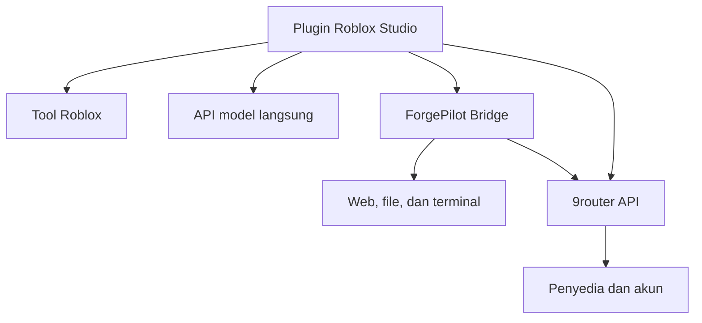

# Arsitektur

Plugin berisi composer/transcript, settings/provider, agent loop, adapter, validator, dan executor Roblox. Runtime terpisah: `runtime/router.mjs` mengelola proses 9router; `runtime/bridge.mjs` hanya membuat bridge. Installer `runtime/install.mjs` menyalin plugin yang checksum-nya cocok.

## Kontrak bridge

Seluruh route memakai Bearer token pairing dan hanya menerima Host localhost; request browser-origin ditolak.

| Route | Fungsi |
| --- | --- |
| `GET /health` | Scope, versi, capability tool jobs dan idle streaming |
| `POST /tools/start` | Mendaftarkan operasi dan segera mengembalikan ID |
| `GET /tools/:id` | Long-poll pendek untuk result/error |
| `POST /cancel` | Membatalkan operasi tool dan child process yang masih hidup |
| `POST /stream` | Memulai relay SSE dengan idle timeout |
| `GET /stream/:id?cursor=N` | Batch event berurutan dan nomor aktivitas upstream |
| `DELETE /stream/:id` | Membatalkan/membersihkan stream |
| `POST /providers/open` | Membuka halaman penyedia pada dashboard router |
| `POST /providers/status` | Membaca status akun terhubung dari router |
| `POST /router/login` | Menyimpan sesi dashboard pada bridge |
| `POST /router/models` | Model beralias penyedia dan metadata yang relevan |

`POST /tools` masih tersedia untuk kompatibilitas, tetapi plugin menggunakan job asinkron. Polling memperbarui waktu consumer untuk cleanup cache; hanya aktivitas upstream yang mereset timeout stream. Parser adapter menafsirkan marker selesai/error protokol, dan closure tanpa marker dilaporkan.

## Penyelesaian dan pembatalan

Satu turn mempunyai generation guard. Callback lama dari turn yang dibatalkan tidak dapat menambahkan teks atau membuka lock turn baru. Error callback/parser tetap menyelesaikan handle dan menutup transport. Agent memegang run lock sampai cleanup lalu melepaskannya pada semua jalur keluar. Partial output tidak diganti oleh pesan error.

Tool results untuk native tool calling dipasangkan dengan ID request model. Panggilan yang tidak dieksekusi karena limit mendapat result penjelasan; argumen terpotong tidak dieksekusi. Continuation internal disimpan sebagai konteks namun tidak ditampilkan sebagai pesan pengguna baru.

## Source dan build

Project Rojo berada di `plugin/src/default.project.json`. Build menghasilkan satu main Script dan ModuleScript dependensi. `tests/luau/` menyimulasikan signal, scheduler, API, layout, dan request fixture; tes Node menjalankan HTTP lokal, file dan subprocess sungguhan. Lihat [CONTRIBUTING](../CONTRIBUTING.md) dan [laporan verifikasi](TEST-REPORT.md) untuk batas verifikasi.
